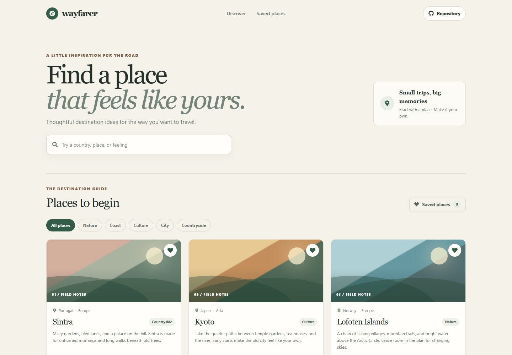

# Destination Discovery Guide

Wayfarer is a small destination guide for travelers who want a starting point for their next trip. Browse a handpicked set of places, narrow the list by travel style, and keep ideas in a private saved list in the current browser.

**Live site:** [https://a2rp.github.io/destination-discovery-guide/](https://a2rp.github.io/destination-discovery-guide/)

## What is included

- A fixed header with links to the destination guide and saved places, plus a repository link.
- A destination search that matches place, country, region, and travel style as you type.
- Travel-style filters for nature, coast, culture, city, and countryside.
- Six curated destination cards with suggested trip length, season, and a short description.
- A saved places filter and a count of saved ideas. Use the heart on a card or in its detail guide to save or remove a place.
- A destination guide dialog with suggested trip length, season, and a save action. Close it with the Close guide button, Escape, or by clicking the backdrop.
- An empty state with a control to restore all destinations when the current filters have no matches.
- A two-sided footer with the project source and profile, social, and support links. A Back to top button appears after scrolling more than 50 pixels.
- Responsive layouts for desktop and mobile. Destination artwork is drawn with local CSS, so the page does not depend on remote image services.

## Privacy and storage

Saved destination IDs are stored in this browser's `localStorage` under `wayfarer-saved`. The guide does not send searches or saved places to a server. Clearing site data removes the saved list. The destination descriptions and seasonal suggestions are editorial starting points; check current entry rules, weather, park access, and local travel guidance before booking.

## Run locally

Use Node.js and npm, then run these commands from this directory:

```sh
npm install
npm run dev
```

## Checks and deployment

```sh
npm run lint
npm run build
npm run deploy
```

The deploy script builds the static site and publishes `dist` to the `gh-pages` branch. Vite uses `/destination-discovery-guide/` as its project-page base path.

## Future improvements

These are ideas and are not implemented yet:

- Add more destinations with verified accessibility and seasonal information.
- Let travelers create custom collections and export them as a shareable list.
- Add an optional map view with links to current official visitor information.
- Add destination suggestions based on trip dates, budget, and travel time.

## Links

- Portfolio: [https://www.ashishranjan.net](https://www.ashishranjan.net)
- GitHub: [https://github.com/a2rp](https://github.com/a2rp)
- CodePen: [https://codepen.io/ash1198](https://codepen.io/ash1198)
- LinkedIn: [https://www.linkedin.com/in/aashishranjan](https://www.linkedin.com/in/aashishranjan)
- Facebook: [https://www.facebook.com/theash.ashish/](https://www.facebook.com/theash.ashish/)
- YouTube: [https://www.youtube.com/@ashishranjan-ashz?sub_confirmation=1](https://www.youtube.com/@ashishranjan-ashz?sub_confirmation=1)
- Email: [mailto:ash.ranjan09@gmail.com](mailto:ash.ranjan09@gmail.com)

## Support

- Support: [https://a2rp-donation-page.netlify.app/](https://a2rp-donation-page.netlify.app/)
- Buy Me a Coffee: [https://buymeacoffee.com/ashishranjan](https://buymeacoffee.com/ashishranjan)
- Patreon: [https://www.patreon.com/ashishranjan](https://www.patreon.com/ashishranjan)
